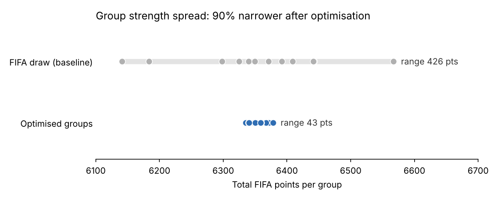

# FIFA World Cup 2026: Tournament Optimisation

**Three linked integer programming models that plan the 48-team 2026 World Cup group stage.** The models cut the spread in group strength by **90%** compared with FIFA's draw, balance spectator demand across the schedule, and re-match games to stadiums to raise capacity-weighted demand by **1.5%**.



## Business problem

The 2026 World Cup is the first with 48 teams, 12 groups and 16 host stadiums in three countries. Organisers have to make three linked decisions:
1. **Which teams play in which group?** Groups should be fair, with no "group of death".
2. **Which group gets which letter (A–L)?** The letter fixes the dates and venues for each group's six matches, and therefore where demand falls across the schedule.
3. **Which stadium hosts which match on each day?** High-demand matches should go to the largest venues.

## Data

The integrated dataset ([`data/FIFA_data.xlsx`](data/FIFA_data.xlsx)) is built from public sources:

| Sheet | Contents |
|---|---|
| Team-Level Data | 48 teams with confederation, FIFA ranking and points, seeding pot, host status, GDP per capita |
| Stadiums | 16 host venues with city, country and capacity |
| Schedule_group | 72 group-stage fixtures (12 groups × 6 matches) |

Sources: FIFA rankings and match schedule, World Bank GDP per capita, FIFA host-venue capacities.

## Approach

All three models are built in **Python with Pyomo** and solved with **GLPK**. They extend the framework of Ghoniem et al. (2017) from the 32-team format to the 48-team format.

| Model | Decision | Objective | Key constraints |
|---|---|---|---|
| **1. Group formation** | Assign 48 teams to 12 groups | Maximise the weakest group's total FIFA points | 4 teams per group, one from each pot; at most 1 team per confederation (2 for UEFA) |
| **2. Group-letter assignment** | Assign the 12 groups to letters A–L | Maximise the least popular date–stadium slot, with a tie-break on total popularity | Hosts fixed: Mexico in A, Canada in B, USA in D |
| **3. Stadium assignment** | Re-assign each day's matches across that day's venues | Maximise capacity × match popularity | One match per stadium per day |

Match popularity uses a **spectator index** for each nation. It is GDP per capita (a proxy for travelling-fan demand) relative to the seats offered to each team (12% of capacity after a 9% officials' allocation).

## Results

**1. Fairer groups.** The gap between the strongest and weakest group fell from 426 to 43 FIFA points, a **90% reduction**. The standard deviation of group totals fell from 114 to 13.

**2. Balanced schedule.** In the final assignment, 72 date–stadium slots have a mean popularity of 3.53 (maximum 4.00). The model raised the weakest slot to 1.16.

| Letter | Teams |
|---|---|
| A | Mexico, Egypt, Australia, Norway |
| B | Canada, Italy, Korea Republic, Tunisia |
| C | Argentina, Morocco, Uzbekistan, New Zealand |
| D | USA, DR Congo, IR Iran, Ecuador |
| E | Germany, Paraguay, Qatar, Switzerland |
| F | Spain, Cabo Verde, Saudi Arabia, Uruguay |
| G | England, Algeria, Iraq, Panama |
| H | Brazil, South Africa, Ukraine, Denmark |
| I | Portugal, Curaçao, Austria, Colombia |
| J | France, Japan, Ghana, Scotland |
| K | Belgium, Croatia, Côte d'Ivoire, Jordan |
| L | Netherlands, Senegal, Haiti, Türkiye |

**3. Better use of stadium capacity.** Re-matching games to venues within each day moved 55 of 72 matches. Total capacity-weighted demand rose from 16.20M to 16.44M (**+1.5%**). The largest venue, New York New Jersey (78,576 seats), now hosts the highest-demand matches.

## Recommendation

Organisers could use Model 1 as a fairness check on the official draw: it shows how unbalanced the actual groups are and which swaps would improve them. Models 2 and 3 show that schedule and venue decisions can be optimised separately from the draw. Even within fixed dates, assigning high-demand matches to larger stadiums is a low-cost way to increase attendance.

## My role

This was a five-person group project for *Advanced Analytics: Models and Applications* on the MSc Business Analytics at Warwick Business School (2026).
- **I led the data design.** I built the integrated dataset of teams, seeding pots, confederations, FIFA points, GDP, stadiums and fixtures that feeds all three models, including proxy values for the six play-off places.
- **I then worked across all three models and the final write-up** with the team.

## Limitations

- **Model 1 is near-optimal.** GLPK reached its 120-second time limit with a 0.3% optimality gap.
- **Baseline data mismatch.** The baseline comparison in the notebook uses 1,160 FIFA points for New Zealand, while the data file uses 1,279.25. This README uses the data file's value for both baseline and optimised groups, which gives 90% rather than the 91.5% in the original report.
- **Iraq's GDP per capita is wrong in the data file.** It shows 71,026.5, which duplicates Denmark's; the correct figure is about 4,900. This inflates Iraq's spectator index in Models 2 and 3 and should be corrected before re-running.
- **GDP per capita is a rough proxy for fan demand.** It ignores diaspora communities, distance to host cities and team popularity.
- **Model 3 only swaps venues on the same day**, so it doesn't account for travel distances between venues.

## Repository structure

```
├── notebooks/fifa_2026_optimisation.ipynb   # all three models with outputs
├── data/FIFA_data.xlsx                      # integrated dataset
├── images/group_balance.png
└── requirements.txt
```

## Tools

Python · Pyomo · GLPK · pandas · NumPy · Matplotlib · Excel

## Reference

Ghoniem, A., Ali, A.I., Al-Salem, M. and Khallouli, W. (2017). Prescriptive analytics for FIFA World Cup lodging capacity planning. *Journal of the Operational Research Society*, 68(10), 1183–1194.
